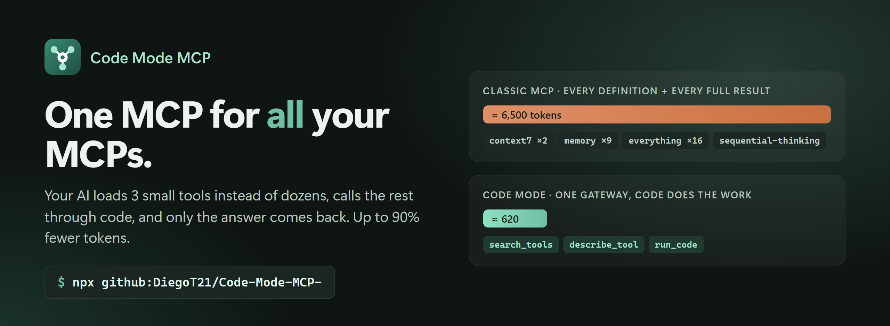
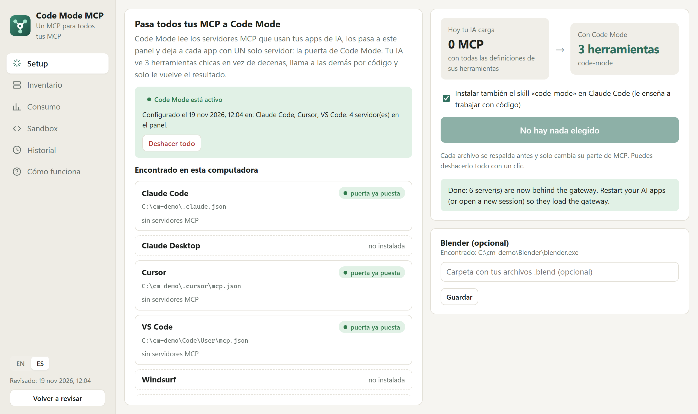
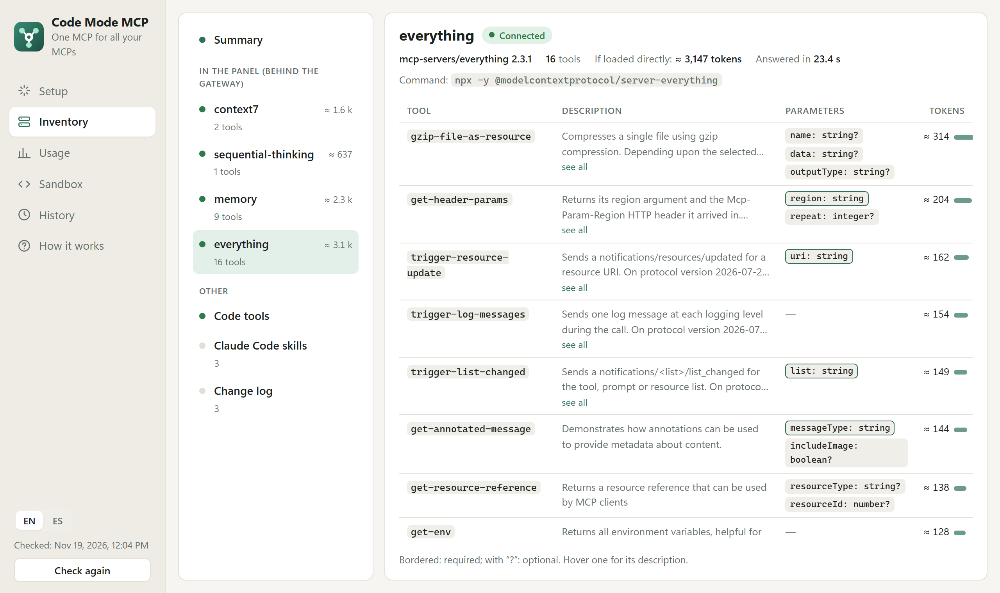
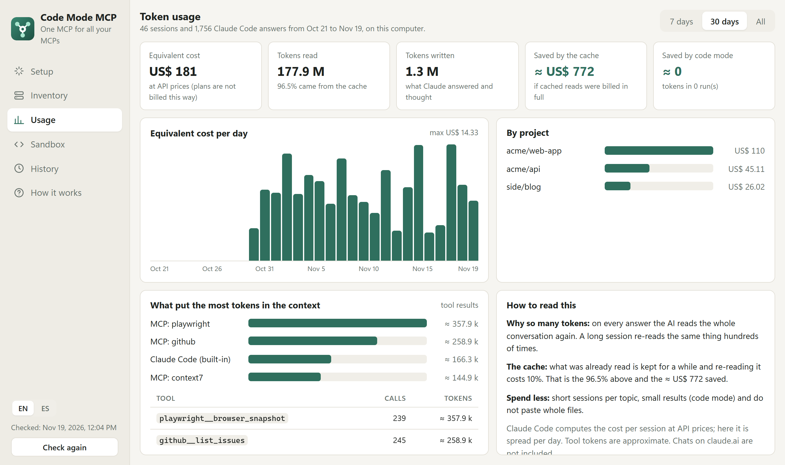
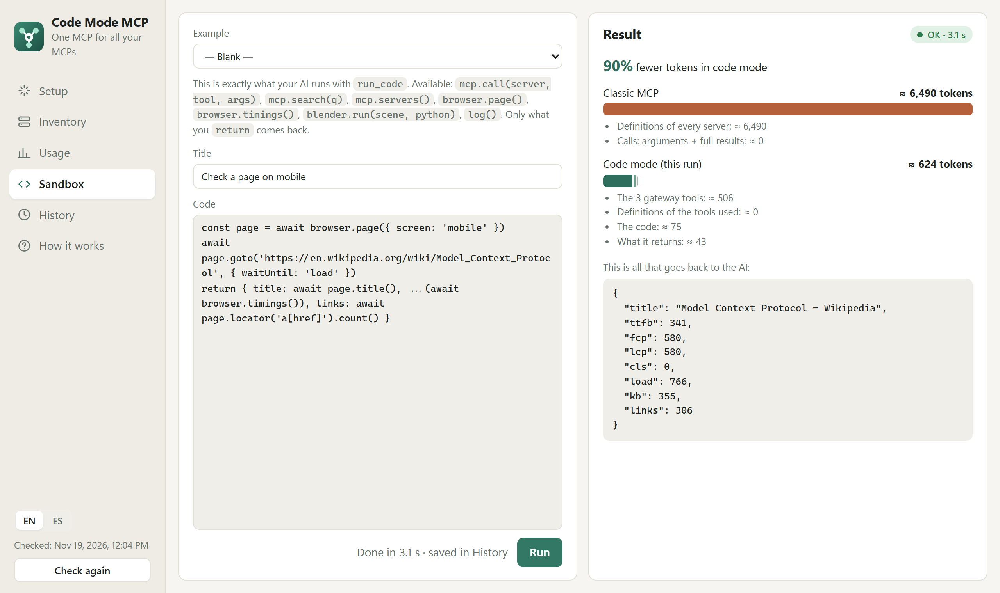
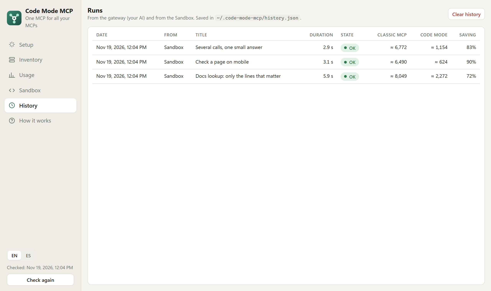

<p align="center">
  
</p>

<p align="center">
  <a href="https://github.com/DiegoT21/Code-Mode-MCP-/releases/latest"></a>
  <a href="https://github.com/DiegoT21/Code-Mode-MCP-/actions/workflows/test.yml"></a>
  
  
  <a href="LICENSE"></a>
</p>

<p align="center">
  <b>Funciona con</b> Claude Code · Claude Desktop · Cursor · VS Code · Windsurf · Gemini CLI
  <br>
  <a href="README.md">Read in English</a>
</p>

---

## Tu IA está pagando por herramientas que nunca usa

Cada servidor MCP que conectas mete **todas las definiciones de sus herramientas** en el contexto de tu IA, en
cada conversación. Diez servidores pueden ser más de 100 herramientas y decenas de miles de tokens antes de que
escribas una palabra. Y cada resultado entra **completo** a la conversación: una página web entera, un
documento de 3.000 líneas, un JSON gigante… aunque la IA solo necesitara un número.

Eso es más lento, más caro y le deja menos espacio a la IA para pensar.

## Code Mode lo arregla con un botón

**Code Mode MCP** pone todos tus servidores MCP detrás de una sola puerta con tres herramientas chiquitas. Tu IA
busca la herramienta que necesita, escribe unas líneas de código que la llaman y **solo le vuelve la respuesta**.
Los datos intermedios se quedan en tu computadora.

```
npx github:DiegoT21/Code-Mode-MCP-
```

Eso abre un panel local. Pulsa **Setup → Pasar a Code Mode**. Encuentra la configuración de MCP de cada app de
IA de tu computadora, pasa los servidores al panel y deja a cada app con un solo servidor: la puerta. Con
respaldo y se deshace con un clic.

<p align="center"></p>

## Medido, no prometido

La misma tarea con los mismos servidores (context7, memory, everything, sequential-thinking). Clásico = lo que la
IA carga y recibe con MCP normal; Code Mode = las 3 herramientas de la puerta + el código + lo que devuelve.

| Tarea | MCP clásico | Code Mode | Ahorro |
|---|---:|---:|---:|
| Buscar documentación y quedarse con lo útil (2 llamadas) | ≈ 8.049 tokens | ≈ 2.272 | **72%** |
| Varias llamadas, una respuesta chica (4 llamadas) | ≈ 6.772 | ≈ 1.154 | **83%** |
| Revisar una página web en celular (navegador por código) | ≈ 6.490 | ≈ 624 | **90%** |

Mientras más servidores tengas y más grandes sean sus resultados, más ahorras. El panel mide cada corrida,
así que lo ves con tus propias herramientas.

## Cómo funciona

La puerta le da a tu IA tres herramientas:

| Herramienta | |
|---|---|
| `search_tools(query)` | Busca herramientas en todos los servidores detrás de la puerta |
| `describe_tool(server, tool)` | Muestra los parámetros de una herramienta |
| `run_code(code)` | Corre JavaScript que llama a las herramientas y devuelve solo lo que importa |

```js
// Lo que tu IA escribe dentro de run_code
const issues = await mcp.call('github', 'list_issues', { repo: 'acme/web', state: 'open' })
return issues
  .filter((i) => i.labels.some((l) => l.name === 'bug'))
  .map((i) => `#${i.number} ${i.title}`)
  .slice(0, 10)          // ← solo estas 10 líneas llegan a la conversación
```

Además trae, sin ningún MCP extra:

- **Navegador por código** — `browser.page({ screen: 'mobile' })` maneja tu Chrome instalado con Playwright y
  `browser.timings()` da TTFB / FCP / LCP / CLS. Reemplaza a un MCP de navegador que metería el árbol de la página al chat.
- **Blender en lote** — `blender.run(escena, python)` corre Python en Blender sin abrirlo (si está instalado).
- **Imágenes cuando importan** — devuelve un objeto de imagen MCP y la IA recibe la imagen.

## Un panel para ver en qué se van tus tokens

<table>
<tr>
<td width="50%"></td>
<td width="50%"></td>
</tr>
<tr>
<td><b>Inventario</b> — cada servidor y herramienta, sus parámetros y cuántos tokens costaría cargado directo.</td>
<td><b>Consumo</b> — consumo real de Claude Code según sus registros locales: costo por día y proyecto, ahorro por caché y qué herramientas te llenan el contexto.</td>
</tr>
<tr>
<td></td>
<td></td>
</tr>
<tr>
<td><b>Sandbox</b> — corre exactamente lo que corre tu IA y compáralo con MCP clásico.</td>
<td><b>Historial</b> — cada <code>run_code</code> de tu IA, con duración, resultado, errores y tokens ahorrados.</td>
</tr>
</table>

En español e inglés, con modo claro y oscuro, y cabe en la ventana sin hacer scroll.

## Empezar

```bash
npx github:DiegoT21/Code-Mode-MCP-
```

1. Se abre el panel en http://localhost:4777.
2. **Setup** muestra las apps de IA y los servidores MCP que encontró. Desmarca los que quieras dejar directos.
3. Pulsa el botón y reinicia tus apps de IA (o abre una sesión nueva).
4. Pídele a tu IA cualquier cosa que use tus herramientas. Mira el ahorro en **Historial**.

¿Te arrepentiste? **Setup → Deshacer todo** devuelve cada servidor a donde estaba.

<details>
<summary><b>Línea de comandos</b></summary>

| Comando | |
|---|---|
| `code-mode-mcp` | Abre el panel (`--app` en su propia ventana) |
| `shortcut` · `shortcut --remove` | Acceso directo en escritorio y menú Inicio que lo abre como app (Windows) |
| `setup` · `setup --apply` · `setup --undo` | El botón de Setup, desde la terminal |
| `add <nombre> --config '<json>' [--env NOMBRE]` | Prueba un servidor y lo agrega detrás de la puerta. Las claves vienen de tu terminal con `--env`, nunca del comando |
| `remove <nombre>` | Quita un servidor (queda respaldo) |
| `list` | Servidores, herramientas y peso en tokens |
| `skill-add <carpeta>` · `skill-remove <nombre>` | Skills de Claude Code |
| `run <archivo.js>` | Corre código como `run_code` |
| `check <url> [--screen mobile]` | Revisión rápida de una página con tu Chrome |
| `usage [--days 7]` | Consumo de tokens de Claude Code |
| `gateway` | El servidor MCP en sí (lo que arrancan tus apps de IA) |

Úsalos como `npx github:DiegoT21/Code-Mode-MCP- <comando>`, o instálalo una vez con
`npm i -g github:DiegoT21/Code-Mode-MCP-`.
</details>

<details>
<summary><b>App de escritorio</b></summary>

**Sin instalador (lo recomendado en Windows):** pulsa **Setup → Crear acceso directo** o corre
`npx github:DiegoT21/Code-Mode-MCP- shortcut`. Queda un acceso directo *Code Mode MCP* en el escritorio y el menú
Inicio que abre el panel en su propia ventana (modo app de Edge o Chrome, sin consola) y lo apaga al cerrarla. En
cualquier sistema, `code-mode-mcp --app` abre esa ventana.

**Instaladores** para Windows, macOS y Linux están en [Releases](https://github.com/DiegoT21/Code-Mode-MCP-/releases/latest).
Es el mismo panel en su propia ventana; igual necesita Node.js 20+. No tienen firma digital, así que Smart App
Control de Windows o Gatekeeper de macOS pueden bloquearlos o advertir. `npx` hace exactamente lo mismo sin instalador.
</details>

## Preguntas frecuentes

**¿Mi IA usa peor las herramientas?**
No: tiene las mismas herramientas, solo que las busca cuando las necesita. Los modelos escriben muy bien código
corto, y hacer varias llamadas en un solo script suele ser más confiable que muchas llamadas sueltas.

**¿Es seguro?**
Todo corre en tu computadora. El panel solo escucha en `127.0.0.1`, rechaza pedidos que no vayan dirigidos a
`localhost` (así una web no puede alcanzarlo con «DNS rebinding») y no acepta cambios que vengan de otras páginas.
Cada archivo de configuración se respalda antes de tocarlo y solo cambia su parte de MCP. Las claves quedan en
`~/.code-mode-mcp/servers.json`, en tu carpeta de usuario, y nunca se muestran. `run_code` **no** es una caja
fuerte: solo recibe `mcp`, `browser`, `blender` y `log`, pero un código decidido puede salirse de ese contexto.
Trátalo como la terminal de tu IA: corre con los permisos de tu usuario.

**¿Cuándo conviene dejar un servidor directo?**
Cuando la IA tiene que mirar y decidir paso a paso en tiempo real (una escena 3D en vivo, una sesión de navegador
interactiva). Desmárcalo en Setup.

**¿Y los conectores de claude.ai (Gmail, Drive…)?**
Viven en tu cuenta de claude.ai y no se pueden pasar a una puerta local.

**¿Qué tan exactos son los números?**
Los tokens son estimados (≈ 3,5 caracteres por token): sirven para comparar, no para facturar. El costo de
Consumo viene de los registros de Claude Code.

## Requisitos

Node.js 20+ · Google Chrome o Microsoft Edge (para el navegador) · Blender (opcional)

## Desinstalar

**Setup → Deshacer todo** (o `npx github:DiegoT21/Code-Mode-MCP- setup --undo`) y borra `~/.code-mode-mcp`.

## Contribuir

Issues y pull requests son bienvenidos, sobre todo para soportar más apps de IA.

```bash
git clone https://github.com/DiegoT21/Code-Mode-MCP-.git && cd Code-Mode-MCP-
npm install
npm test     # Setup, puerta y Deshacer contra configuraciones falsas
npm start    # el panel
```

Si Code Mode te ahorra tokens, una ⭐ ayuda a que otras personas lo encuentren.

Licencia MIT
