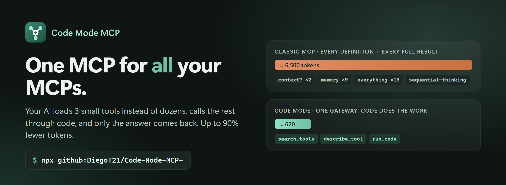
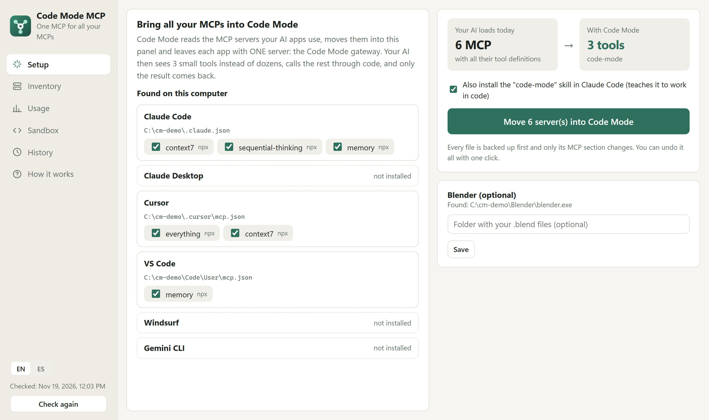
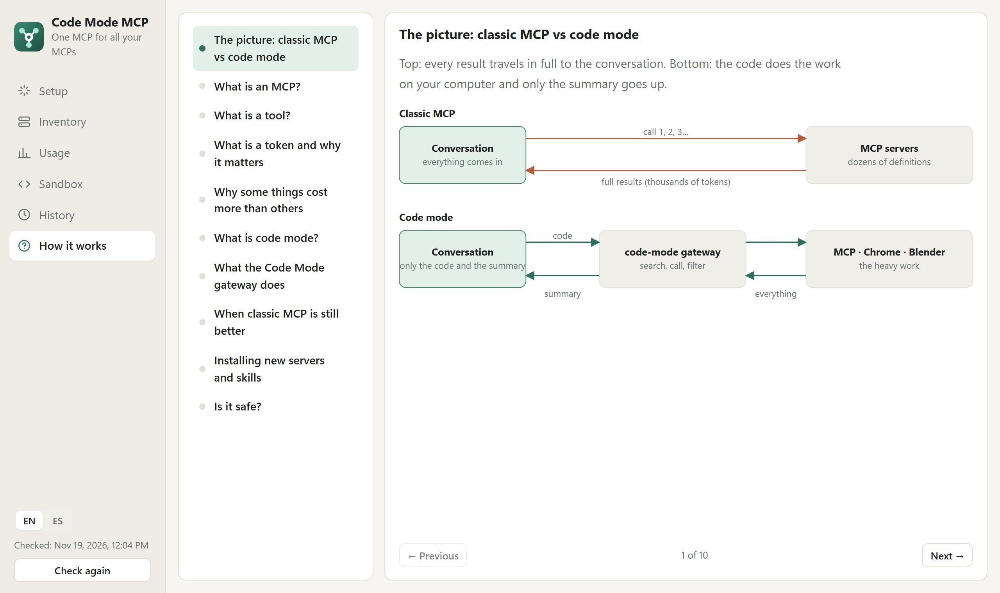
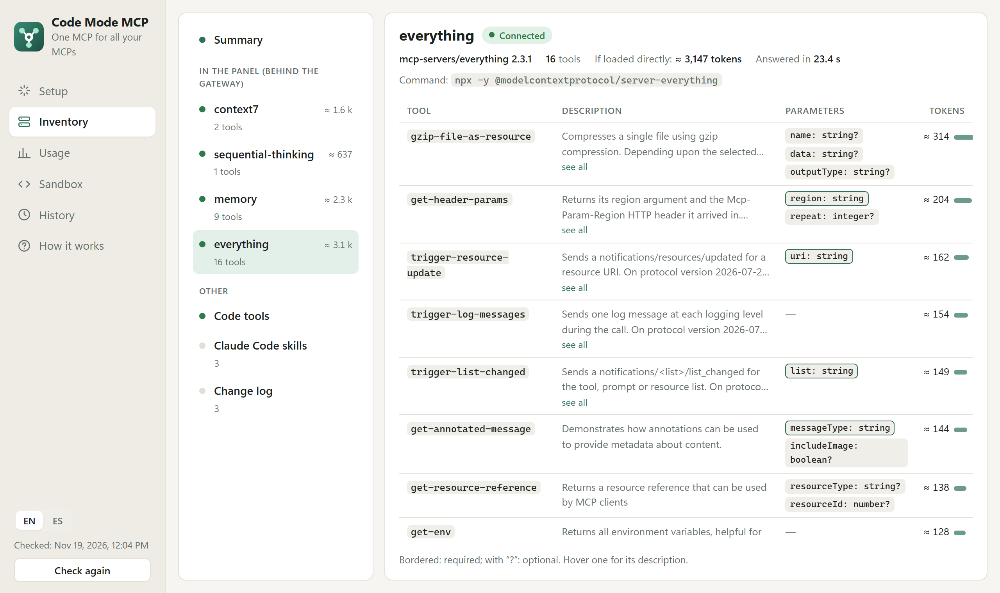
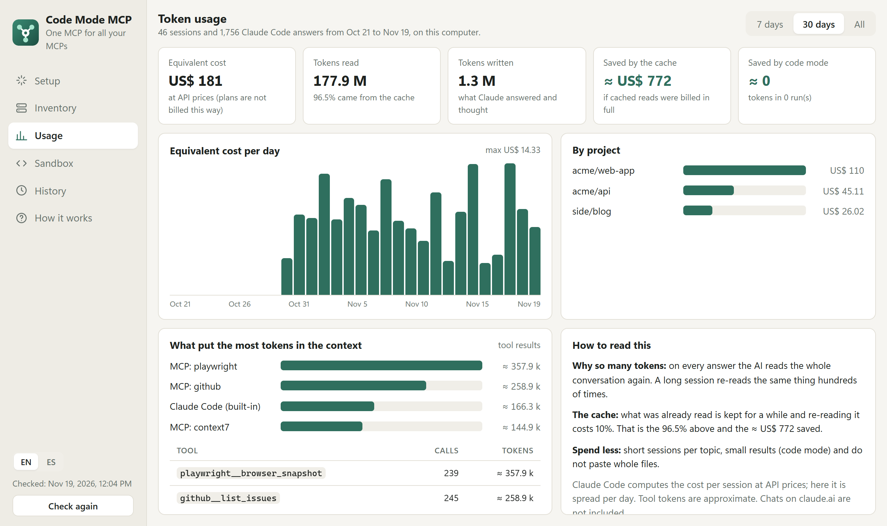
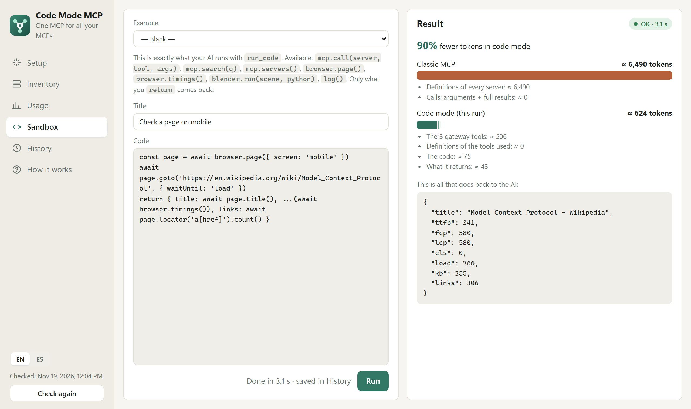
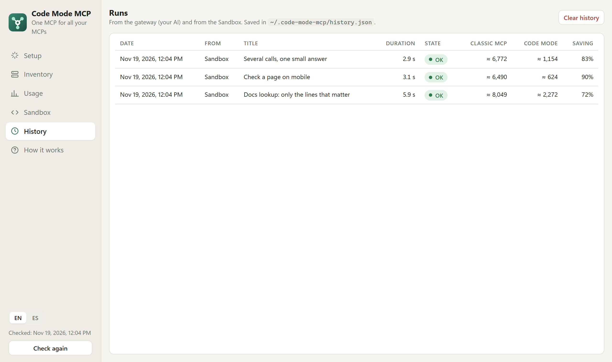

<p align="center">
  
</p>

<p align="center">
  <a href="https://github.com/DiegoT21/Code-Mode-MCP-/releases/latest"></a>
  <a href="https://github.com/DiegoT21/Code-Mode-MCP-/actions/workflows/test.yml"></a>
  
  
  <a href="LICENSE"></a>
</p>

<p align="center">
  <b>Works with</b> Claude Code · Claude Desktop · Cursor · VS Code · Windsurf · Gemini CLI
  <br>
  <a href="README.es.md">Leer en español</a>
</p>

---

## Your AI is paying for tools it never uses

Every MCP server you connect sends **all its tool definitions** into your AI's context, on every
conversation. Ten servers can mean 100+ tools and tens of thousands of tokens before you type a word.
Then every tool result lands in the chat **in full** — a whole web page, a 3,000-line document, a giant
JSON — even when the AI only needed one number.

That is slower, more expensive, and leaves less room for the AI to think.

## Code Mode fixes it with one button

**Code Mode MCP** puts all your MCP servers behind a single gateway with three tiny tools. Your AI
searches for the tool it needs, writes a few lines of code that call it, and **only the answer comes back**.
Intermediate data stays on your computer.

```
npx github:DiegoT21/Code-Mode-MCP-
```

That opens a local panel. Press **Setup → Move into Code Mode**. It finds the MCP config of every AI app
on your computer, moves the servers into the panel, and leaves each app with one server: the gateway.
Backed up, and undoable with one click.

<p align="center"></p>

## Measured, not promised

Same task, same servers (context7, memory, everything, sequential-thinking). Classic = what the AI loads and
receives with normal MCP; Code Mode = the gateway's 3 tools + the code + what it returns.

| Task | Classic MCP | Code Mode | Saved |
|---|---:|---:|---:|
| Look up docs and keep only the relevant lines (2 calls) | ≈ 8,049 tokens | ≈ 2,272 | **72%** |
| Several calls, one small answer (4 calls) | ≈ 6,772 | ≈ 1,154 | **83%** |
| Check a web page on mobile (browser in code) | ≈ 6,490 | ≈ 624 | **90%** |

The more servers you have and the bigger their results, the bigger the saving. The panel measures every
run, so you can see it on your own tools.

## How it works

<p align="center"></p>

The gateway gives your AI three tools:

| Tool | |
|---|---|
| `search_tools(query)` | Find tools across every server behind the gateway |
| `describe_tool(server, tool)` | See one tool's parameters |
| `run_code(code)` | Run JavaScript that calls the tools and returns only what matters |

```js
// What your AI writes inside run_code
const issues = await mcp.call('github', 'list_issues', { repo: 'acme/web', state: 'open' })
return issues
  .filter((i) => i.labels.some((l) => l.name === 'bug'))
  .map((i) => `#${i.number} ${i.title}`)
  .slice(0, 10)          // ← only these 10 lines reach the conversation
```

Also built in, no extra MCP needed:

- **Browser in code** — `browser.page({ screen: 'mobile' })` drives your installed Chrome with Playwright and
  `browser.timings()` gives TTFB / FCP / LCP / CLS. Replaces a browser MCP that would dump the page tree into the chat.
- **Blender in batch** — `blender.run(scene, python)` runs Python in Blender without opening it (if installed).
- **Images when they matter** — return an MCP image object and the AI gets the picture.

## A panel to see where your tokens go

<table>
<tr>
<td width="50%"></td>
<td width="50%"></td>
</tr>
<tr>
<td><b>Inventory</b> — every server and tool, its parameters and how many tokens it would cost loaded directly.</td>
<td><b>Usage</b> — real Claude Code usage from its local logs: cost per day and project, cache savings, and which tools flood your context.</td>
</tr>
<tr>
<td></td>
<td></td>
</tr>
<tr>
<td><b>Sandbox</b> — run exactly what your AI runs and compare it with classic MCP.</td>
<td><b>History</b> — every <code>run_code</code> from your AI, with duration, result, errors and tokens saved.</td>
</tr>
</table>

English and Spanish, light and dark mode, and it fits the window without scrolling.

## Quick start

```bash
npx github:DiegoT21/Code-Mode-MCP-
```

1. The panel opens at http://localhost:4777.
2. **Setup** shows the AI apps and MCP servers it found. Untick any server you want to keep direct.
3. Press the button, then restart your AI apps (or open a new session).
4. Ask your AI anything that uses your tools. Watch the savings in **History**.

Changed your mind? **Setup → Undo everything** puts every server back where it was.

<details>
<summary><b>Command line</b></summary>

| Command | |
|---|---|
| `code-mode-mcp` | Open the panel (`--app` for its own window) |
| `shortcut` · `shortcut --remove` | Desktop and Start menu shortcut that opens it as an app (Windows) |
| `setup` · `setup --apply` · `setup --undo` | The Setup button, from the terminal |
| `add <name> --config '<json>' [--env NAME]` | Test a server and add it behind the gateway. Keys come from your terminal with `--env`, never from the command line |
| `remove <name>` | Remove a server (backup kept) |
| `list` | Servers, tools and token weight |
| `skill-add <folder>` · `skill-remove <name>` | Claude Code skills |
| `run <file.js>` | Run code like `run_code` |
| `check <url> [--screen mobile]` | Quick page check with your Chrome |
| `usage [--days 7]` | Claude Code token usage |
| `gateway` | The MCP server itself (what your AI apps start) |

Use them as `npx github:DiegoT21/Code-Mode-MCP- <command>`, or install once with
`npm i -g github:DiegoT21/Code-Mode-MCP-`.
</details>

<details>
<summary><b>Desktop app</b></summary>

**No installer (recommended on Windows):** press **Setup → Create shortcut**, or run
`npx github:DiegoT21/Code-Mode-MCP- shortcut`. You get a *Code Mode MCP* shortcut on the desktop and in the Start
menu that opens the panel in its own window (Edge/Chrome app mode, no console) and stops it when you close the
window. On any system, `code-mode-mcp --app` opens that window.

**Installers** for Windows, macOS and Linux are on the [Releases](https://github.com/DiegoT21/Code-Mode-MCP-/releases/latest)
page. Same panel, in its own window; it still needs Node.js 20+. They are not code-signed, so Windows Smart App
Control or macOS Gatekeeper may block or warn. `npx` does exactly the same without an installer.
</details>

## FAQ

**Does my AI get worse at using tools?**
No: it gets the same tools, found on demand. Models are very good at writing short code, and doing several
calls in one script is often more reliable than many separate tool calls.

**Is it safe?**
Everything runs locally. The panel only listens on `127.0.0.1`, rejects requests not addressed to `localhost`
(so a website cannot reach it through DNS rebinding) and refuses changes coming from other pages. Every config
file is backed up before it is touched and only its MCP section changes. Keys stay in
`~/.code-mode-mcp/servers.json` in your user folder and are never shown. `run_code` is **not** a security
sandbox: it is handed only `mcp`, `browser`, `blender` and `log`, but determined code can get out of that
context. Treat it like your AI's own terminal — it runs with your user's permissions.

**When should a server stay direct?**
When the AI must look and decide step by step in real time (a live 3D scene, an interactive browser session).
Untick it in Setup.

**What about claude.ai connectors (Gmail, Drive…)?**
They live in your claude.ai account and cannot be moved to a local gateway.

**How accurate are the numbers?**
Token counts are estimates (≈ 3.5 characters per token) — good for comparing, not for billing. The Usage
cost comes from Claude Code's own logs.

## Requirements

Node.js 20+ · Google Chrome or Microsoft Edge (for the browser tools) · Blender (optional)

## Uninstall

**Setup → Undo everything** (or `npx github:DiegoT21/Code-Mode-MCP- setup --undo`), then delete `~/.code-mode-mcp`.

## Contributing

Issues and pull requests are welcome — especially support for more AI apps.

```bash
git clone https://github.com/DiegoT21/Code-Mode-MCP-.git && cd Code-Mode-MCP-
npm install
npm test     # Setup, gateway and Undo against fake configs
npm start    # the panel
```

If Code Mode saves you tokens, a ⭐ helps other people find it.

MIT License
